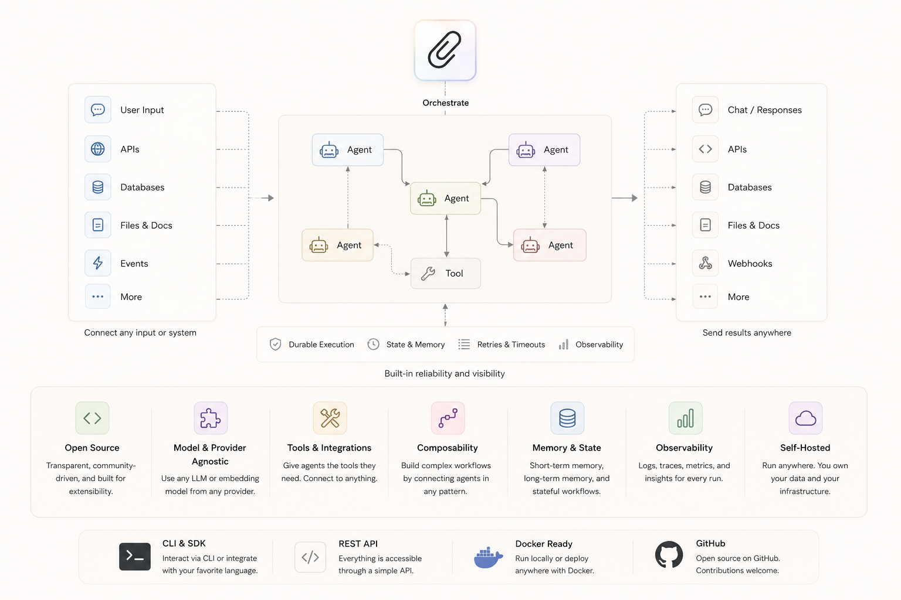

# Paperclip

Deployment templates for [Paperclip](https://github.com/paperclipai/paperclip), the open-source AI agent orchestration platform for autonomous agent companies.

## Deployments

| Platform | Folder | Guide |
|---|---|---|
| [Railway](https://railway.com/?referralCode=alphasec) | [`/railway`](./railway) | [README](./railway/README.md) |
| [DigitalOcean](https://m.do.co/c/5552e11c260f) | [`/digitalocean`](./digitalocean) | [README](./digitalocean/README.md) |

## Choosing a Platform

**Railway**: one-click deploy, no server management, automatic HTTPS, managed Postgres. Usage-based billing; expect roughly $10-15/month at idle, more while agents are working.

**DigitalOcean**: fixed monthly cost, full server control, bring your own domain. Requires `doctl`; $12/month on the default droplet, $24/month for 4GB if you run several agents at once.

Both deployments run the official `ghcr.io/paperclipai/paperclip:latest` image in production mode, print the admin invite URL to the logs, and close sign-up automatically once the admin account is created.

## Related

- [Stop Hiring, Start Orchestrating: Running an AI Agent Company with Paperclip on Railway](https://alphasec.io/stop-hiring-start-orchestrating-running-an-ai-agent-company-with-paperclip-on-railway)
- [Stop Hiring, Start Orchestrating: Running an AI Agent Company with Paperclip on DigitalOcean](https://alphasec.io/stop-hiring-start-orchestrating-running-an-ai-agent-company-with-paperclip-on-digitalocean)
- [Paperclip documentation](https://docs.paperclip.ing)
- [Paperclip companies](https://paperclip.community/companies): agent companies shared by the community
